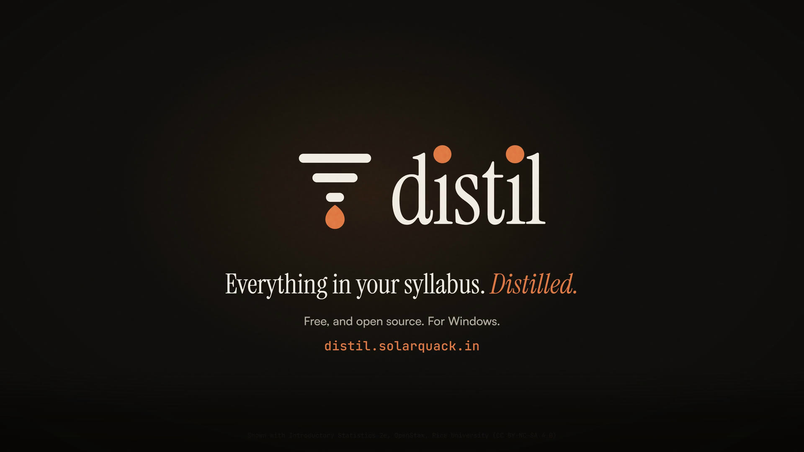

<p align="center">
  <a href="https://distil.solarquack.in"></a>
</p>

<h1 align="center">Distil</h1>

<p align="center"><strong>Everything in your syllabus, distilled.</strong></p>

<p align="center">
  <a href="https://distil.solarquack.in">Website and film</a> ·
  <a href="https://github.com/jeelnadaa/distil/releases/latest/download/Distil-win-x64.zip">Download for Windows</a> ·
  <a href="https://github.com/jeelnadaa/distil/releases">Releases</a>
</p>

A local-first, open-source study app. Bring your material (PDFs, slides, notes, photos, links,
YouTube) or just a goal, and get a study plan that provably covers everything in it. Then learn it
in the same app: an AI teacher that probes what you know, teaches one step at a time with
diagrams and interactive mini-apps, checks you after every step, and keeps you retaining it with
practice exams, flashcards, a knowledge graph and progress tracking.

It runs on your computer with your own model keys. Your library stays in a folder on your disk, and every
token is on the record. See [PROGRESS.md](PROGRESS.md) for where the project stands.

## Install on Windows

1. Download [Distil-win-x64.zip](https://github.com/jeelnadaa/distil/releases/latest/download/Distil-win-x64.zip) and unzip it.
2. Right-click `Install.ps1` and choose *Run with PowerShell*. It installs for your user only, without admin rights.
   The app isn't code-signed yet, so Windows may warn you first.
3. Open Distil from the Start menu and add a provider key under Settings › Providers. Google AI Studio has a free tier.

New versions install from inside the app, under Settings › About.

## Clone and run

Needs [Node.js](https://nodejs.org) 24 or newer, on Windows, macOS or Linux.

```bash
git clone https://github.com/jeelnadaa/distil.git
cd distil
npm install
npm run fonts   # downloads Satoshi once (its licence doesn't allow committing it)
npm run dev     # http://127.0.0.1:5173
```

For a production build: `npm run build`, then `npm start` (http://127.0.0.1:4321).

Your data lives in `~/Distil`; set `DISTIL_DATA_DIR` to put it elsewhere. Keys stay in that folder and are only
sent to their own provider. Settings › Appearance changes the theme, the colour palette and the text font (Satoshi,
Anthropic Sans if you have it installed, or any font of your own). Settings › Data makes and restores backups. Press
`?` for keyboard shortcuts, and open the *How to use Distil* chat for a tour.

| Command | What |
|---|---|
| `npm test` | Tests |
| `npm run check` | Type checks |
| `npm run package` | Windows build in `release/` (Windows x64 only). Add `-- --feed <URL>` to build one that checks for updates |

## Releases

Every push to `main` that changes the app runs [.github/workflows/release.yml](.github/workflows/release.yml): it
tests, packages and publishes a GitHub release named `v<major>.<minor>.<run number>`, with the update feed that
installed copies read. Changes only to `site/`, `design/`, `evals/` or Markdown don't make a release.

The website in [site/](site/) is plain static files, deployed separately to Cloudflare Pages.

## Highlights

- **Brief Compiler** — turns a vague prompt into a full study spec, so output quality does not depend on prompt-writing skill.
- **Coverage Ledger** — every concept, formula and example in your material is extracted and tracked; the plan is checked in code to cover 100 % of it.
- **Four modes** — Study Plan, Teach (Socratic), Practice & Mock Exams, Quick Q&A.
- **Interactive learning** — plots, flowcharts, step-through derivations, simulations; you control how much with an interactivity dial.
- **Subject workspaces** — nested folders (up to 5 levels) sharing materials, plan, ledger and deck.
- **Retention** — flashcards with spaced repetition, mastery view, knowledge graph, opt-out streaks.
- **Your keys, your data** — bring your own provider keys or (experimental) sign in with Google for Gemini; everything stays on your machine. Token usage graphs and spending caps built in.
- **Never stuck on a rate limit** — each model slot has an ordered fallback list across keys and providers; Distil moves to the next model when one is busy or out of quota, and tells you which one answered.
- **Answers from your sources** — a local keyword index is built at import, and embeddings (from your provider or a local model, small to large) add meaning-based search; every answer cites the page it came from.

## Documentation

| File | What |
|---|---|
| [plan.md](plan.md) | Full scope, decisions, feature IDs, phases |
| [DESIGN.md](DESIGN.md) | UX flows, screens, visual system |
| [design/](design/index.html) | Clickable mock-ups. Run `bash design/scripts/fetch-fonts.sh` once (Satoshi can't be committed), then `python -m http.server 4173 --directory design` |
| [PROGRESS.md](PROGRESS.md) | Current status |
| [AGENTS.md](AGENTS.md) | Rules for coding agents working on this repo |
| [site/](site/) | The public website, with the launch film and download page |

## Credits

The idea and the teaching theory (probe → plan → teach one reasoning step at a time → check →
practice, plus the cross-session knowledge graph) come from
[LearnHarness](https://github.com/amosblomqvist/learnharness) by amosblomqvist (AGPL-3.0).
This project is an independent re-implementation — no code is copied. What we add on top:
material ingestion with an enforced coverage ledger, a brief compiler for weak prompts, nested
subject workspaces, deadline scheduling, a typed widget catalog with an interactivity dial,
mock exams, flashcards with spaced repetition, mastery tracking, and token caps with usage graphs.

## License

[MIT](LICENSE); bundled software is listed in [CREDITS.md](CREDITS.md). Fonts keep their own licences: Instrument Serif and JetBrains Mono are SIL OFL;
Satoshi (ITF Free Font Licence) is downloaded by `npm run fonts`, not shipped in this repository.
